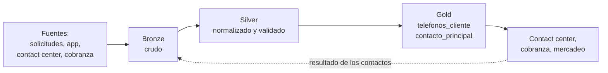

# Ejercicio 1 - Dataset confiable de teléfonos

El ejercicio pide diseñar un proceso automatizado, controlado con CI/CD, para crear y mantener un dataset de teléfonos de clientes que sirva para contactarlos mejor.

Es un ejercicio conceptual, pero quise que no quedara solo en papel: la regla más importante del diseño, la que limpia y valida los números, está implementada en `telefonos/normalizacion.py`, con pruebas que corren en el CI del repositorio.

## El problema

Cualquiera que haya trabajado con datos de clientes ha visto esto: el mismo número escrito de cinco formas distintas (`300 123 4567`, `+57-300-1234567`, `3001234567.0` porque pasó por Excel), fijos con el formato de antes de 2021 que ya no funcionan así, números de relleno como `3000000000` que alguien digitó para pasar un campo obligatorio, y clientes con cuatro teléfonos sin que nadie sepa cuál contesta.

Así que el reto no es solo limpiar una vez, sino que el dataset se mantenga bueno con el tiempo y que cualquier cambio en su lógica pase por un proceso controlado.

## De dónde vienen los teléfonos

En una entidad como Tuya los teléfonos pueden llegar de la solicitud de crédito (en tienda o digital), de las actualizaciones de datos en la app o la web, del contact center, de las gestiones de cobranza y del maestro de clientes. No todas valen lo mismo: un número que el cliente actualizó en la app y validó con un código por SMS es mucho más confiable que una referencia que dejó en una gestión de cobranza hace tres años.

Hay una fuente más, que para mí es la más importante: **el resultado de los contactos**. Si llamamos y contestó el titular, o si un SMS se entregó, eso es evidencia de que el número sirve. Un número puede tener el formato perfecto y no servir para nada; lo único que lo demuestra es usarlo.

## Arquitectura

Propongo trabajarlo por capas:



- **Bronze:** una copia tal cual de lo que llega de cada fuente, más la fuente, la fecha y el id de la carga. Aquí no se transforma nada, así que si mañana cambia una regla se puede reprocesar todo desde el principio.
- **Silver:** una fila por cliente, fuente y número, con el número ya normalizado y un estado (válido, corregido, sospechoso o inválido). Lo que no sirve no se borra: va a una tabla de cuarentena con el motivo, para que el dueño de la fuente lo corrija.
- **Gold:** lo que consume el negocio. Una tabla con todos los números válidos de cada cliente y su puntaje de confianza, guardando la historia (SCD tipo 2, para saber qué número tenía alguien en una fecha dada), y otra con el mejor móvil y el mejor fijo de cada cliente.

La flecha punteada es la parte que más me interesa: lo que pasa cuando el contact center o cobranza usan un número vuelve al pipeline y ajusta su puntaje.

## Cómo se limpian y validan los números

Esta es la parte que implementé. Las reglas salen del plan de numeración colombiano vigente desde 2021:

| Si llega... | Queda... |
|---|---|
| `(300) 123-4568`, `+57 300 123 4568`, `3001234568.0` | `+573001234568`, móvil, válido |
| `601 345 6789` (fijo actual: 60 + región + 7 dígitos) | `+576013456789`, fijo, válido |
| `(4) 444 1234` (fijo como se marcaba antes) | `+576044441234`, corregido |
| `444 1234` (7 dígitos, sin indicativo) | Se completa solo si se conoce la ciudad del cliente; si no, inválido |
| `3000000000`, `3111111111`, `3001234567` | Sospechoso: tiene pinta de número de relleno |
| `12345`, `+1 305...` | Inválido, con el motivo |

El estado queda como una columna y no como un filtro, porque así se puede medir cuántos números llegan malos de cada fuente (eso es parte del ejercicio 2).

## Cuál número usar

Si un cliente tiene varios números, hay que decidir cuál usar. A cada número le daría un puntaje de 0 a 100, armado más o menos así:

- **contactabilidad (40 %):** si hubo contacto efectivo reciente (contestó el titular o se entregó el SMS);
- **recencia (25 %):** cuánto hace que se actualizó o se confirmó;
- **fuente (20 %):** no es lo mismo un número validado con OTP que una referencia de cobranza;
- **consistencia (15 %):** si aparece en varias fuentes para el mismo cliente.

A eso le restaría puntos si el número está asociado a varios clientes (puede ser el de un familiar o una oficina), si ha fallado varias veces seguidas o si alguien reportó que no es del titular. Los pesos son un punto de partida; lo correcto sería calibrarlos con el histórico de contactos.

El número principal es el de mayor puntaje por cliente y tipo; si hay empate, el más reciente:

```sql
SELECT *
FROM (
    SELECT
        t.*,
        ROW_NUMBER() OVER (
            PARTITION BY id_cliente, tipo_telefono
            ORDER BY score_confianza DESC, fecha_ultima_confirmacion DESC
        ) AS prioridad
    FROM silver.telefonos_validados AS t
    WHERE estado IN ('VALIDO', 'CORREGIDO')
) AS ranking
WHERE prioridad = 1;
```

## El dataset final

Las columnas principales de `gold.telefonos_cliente` serían: el id del cliente; el número en formato `+57...` (cifrado); el tipo (móvil o fijo); el estado; el puntaje; las fuentes donde aparece; la fecha en que se capturó y la última vez que se confirmó; el último resultado de contacto; si el cliente autorizó que lo contacten y por qué canales; las fechas de vigencia para la historia; y, para la trazabilidad, el id de la carga y la versión del pipeline que generó la fila.

## Datos personales

Un teléfono es un dato personal, así que esto va desde el diseño y no como algo que se agrega después. Por la Ley 1581 de 2012 (habeas data), solo se contacta por los canales que el cliente autorizó, y esa autorización viaja como columna del dataset. La Ley 2300 de 2023 limita los horarios y la frecuencia de contacto para cobranza y temas comerciales, así que el dataset expone el último contacto para que las herramientas de marcación lo respeten. También están el Registro de Números Excluidos de la CRC para campañas, el cifrado, el enmascaramiento (un analista ve `+57300***4568`) y el acceso por roles. Fuera de producción solo debería haber datos anonimizados.

## CI/CD

Todo lo que define el dataset vive en Git: las transformaciones, las reglas de calidad, el contrato del dataset (columnas, tipos y llaves), la infraestructura y la configuración del orquestador. Cualquier cambio sigue el mismo camino:

```
rama nueva → pull request → CI → revisión → merge a develop → deploy a QA → tag de versión → aprobación → deploy a PROD
```

En el CI de cada pull request corren, en orden: revisión de estilo de Python y SQL, búsqueda de credenciales en el código, pruebas unitarias de las reglas y, al final, una construcción completa del modelo en un esquema temporal con datos de muestra anonimizados, donde corren las pruebas de datos.

Lo más importante es que **las pruebas de datos bloquean**. No son un reporte que alguien mira después: si el porcentaje de números inválidos se dispara, si aparecen duplicados o si un cliente queda con dos números principales, el cambio no se puede fusionar. Lo mismo en producción: si después de desplegar los indicadores salen de rango, se vuelve a la versión anterior del código y de la tabla (con Delta Lake se puede volver a una versión anterior de la tabla).

Otros puntos: ambientes separados con credenciales distintas, producción solo desde un tag y con aprobación de otra persona, la infraestructura creada con Terraform para que QA y producción sean iguales, y cada fila del dataset con la versión del pipeline que la generó.

En [`cicd/pipeline_telefonos.yml`](cicd/pipeline_telefonos.yml) dejé un ejemplo de cómo se vería el workflow. Está fuera de `.github/workflows` a propósito, porque usa herramientas (dbt, Databricks, Terraform) que este repositorio no tiene; el CI que sí corre aquí está en `.github/workflows/ci.yml`.

## Operación

La carga sería incremental, diaria o por eventos para lo que llega de la app. Si la capa silver no pasa sus pruebas, gold no se actualiza y se queda con la última versión buena: es mejor tener datos de ayer que datos malos de hoy. Los resultados de contacto entran todos los días y recalculan los puntajes, así que un número que deja de contestar baja de prioridad solo. Los inválidos se le reportan a cada fuente con el motivo. Y todo se monitorea con indicadores de calidad, frescura y volumen, que es el tema del ejercicio 2.

## Herramientas

El diseño no depende de una herramienta, pero si tuviera que escoger: Delta Lake sobre S3 o ADLS para guardar, Databricks para procesar, dbt para las transformaciones y sus pruebas (con Great Expectations si hace falta algo más), Databricks Workflows o Airflow para orquestar, GitHub Actions para el CI/CD, Terraform para la infraestructura y Unity Catalog o DataHub para el catálogo y el linaje.

## Lo que está implementado en este repositorio

```
ejercicio_1_dataset_telefonos/
├── telefonos/normalizacion.py     # la regla de normalización y validación
├── tests/test_normalizacion.py    # pruebas (corren en el CI)
└── cicd/pipeline_telefonos.yml    # ejemplo del workflow del proyecto real
```

```bash
python -m unittest -v
```

```python
>>> from telefonos import normalizar_telefono
>>> normalizar_telefono("(4) 444 1234")
ResultadoTelefono(original='(4) 444 1234', e164='+576044441234', tipo=<TipoTelefono.FIJO: 'FIJO'>,
                  estado=<EstadoTelefono.CORREGIDO: 'CORREGIDO'>, motivo='fijo con formato anterior a 2021')
```
