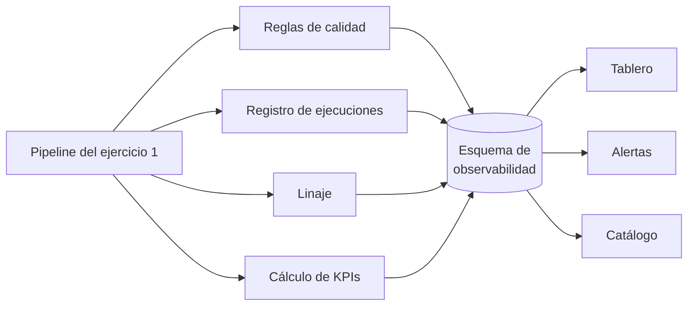

# Ejercicio 2 - Veeduría de calidad, trazabilidad y KPIs

Aquí propongo cómo vigilar la calidad del dataset de teléfonos del ejercicio 1: que los equipos de negocio puedan ver qué tan confiable es, de dónde sale cada dato y cómo van los indicadores de contactabilidad de los clientes.

## Empecé por las preguntas

Antes de pensar en herramientas me pregunté qué querría saber cada persona que usa el dataset, sin tener que pedírselo al equipo de datos:

- **Cobranza, servicio y mercadeo:** ¿a cuántos de mis clientes puedo contactar por celular?
- **Cualquiera que vaya a usar los datos:** ¿los datos de hoy ya están listos y son confiables?
- **Los dueños de cada fuente:** ¿qué fuente está mandando datos malos?
- **Servicio al cliente o auditoría:** ¿por qué este cliente tiene este número como principal?
- **Ingeniería de datos:** ¿mejoró o empeoró la calidad después del último cambio?
- **Cumplimiento:** ¿estamos contactando solo a quien lo autorizó?

La herramienta tiene que poder responder todo eso.

## Cómo funciona

La idea central es que cada corrida del pipeline del ejercicio 1 deje registro de sí misma, sin que nadie tenga que hacer nada a mano: qué corrió, con qué versión del código, qué datos leyó y escribió, y cómo le fue en las reglas de calidad. Encima de ese registro se calculan los KPIs y se arma el tablero.

Son cinco piezas:

**1. Reglas de calidad.** Las reglas están guardadas en una tabla (`dq_regla`) con su descripción, la dimensión de calidad que miden, dos umbrales (advertencia y crítico), si bloquean o no la publicación, y quién es el responsable. En cada corrida se evalúan y el resultado queda en `dq_resultado`, separado por fuente. Que los umbrales estén en una tabla y no en el código hace que negocio los pueda ajustar sin pedir un despliegue.

**2. Registro de ejecuciones.** Cada paso del pipeline deja una fila en `pipeline_ejecucion` con la versión del código (el tag y el commit de Git), cuánto se demoró y cuántos registros leyó, escribió y mandó a cuarentena.

**3. Linaje.** En dos niveles. El primero es por tabla: qué tablas leyó y escribió cada paso. Lo captura OpenLineage automáticamente desde Spark y dbt, y se ve como un grafo en el catálogo. El segundo es por registro: en `linaje_telefono` queda, para cada número de gold, de qué fuente salió, cómo llegó originalmente (enmascarado), cuándo se capturó y qué reglas de limpieza se le aplicaron. Ese es el que responde "¿por qué este cliente tiene este número?".

**4. KPIs.** Al final de cada corrida se calculan y se guardan como una foto diaria en `kpi_telefonos_diario`. Así la historia no cambia si después se reprocesa el dataset, y el tablero no tiene que recalcular sobre millones de filas cada vez que alguien lo abre.

**5. Tablero, alertas y catálogo**, que es lo que ve la gente.

Las tablas están en [`sql/01_modelo_observabilidad.sql`](sql/01_modelo_observabilidad.sql) y el cálculo de los KPIs en [`sql/02_kpis.sql`](sql/02_kpis.sql).

## Qué se mide

Las reglas cubren las dimensiones de calidad más usadas:

- **Completitud:** ¿el dato está? Por ejemplo, que el teléfono no venga vacío.
- **Validez:** ¿cumple el formato? Que el número tenga el formato `+57` con 10 dígitos válidos. Esta bloquea.
- **Exactitud:** ¿es real? Que no sea un número de relleno, y que haya tenido contacto efectivo.
- **Unicidad:** ¿está una sola vez? Que no haya duplicados por cliente y número, y que cada cliente tenga un solo principal por tipo. Esta también bloquea.
- **Consistencia:** ¿cuadra con lo demás? Por ejemplo, que un número no esté asociado a más de tres clientes.
- **Oportunidad:** ¿llegó a tiempo? Que la carga termine antes de las 6 de la mañana.

## KPIs para negocio

Estos son los que propongo. Las metas son un punto de partida para acordar con cada área:

| KPI | Cómo se calcula | Meta |
|---|---|---|
| Cobertura de móvil válido | % de clientes activos con al menos un móvil válido | 95 % |
| Móvil actualizado | % de clientes con el móvil confirmado en el último año | 70 % |
| Contacto efectivo | De los clientes contactados en los últimos 30 días, % en que contestó el titular | 60 % |
| Puntaje promedio | Promedio del puntaje de confianza del número principal | 75 |
| Válidos por fuente | % de registros de cada fuente que llegaron usables | 90 % |
| Números compartidos | % de números asociados a más de un cliente | menos de 2 % |
| Autorización de contacto | % de números principales con autorización vigente | 100 % |
| Datos a tiempo | % de días en que el dataset estuvo listo antes de las 6 a. m. | 98 % |

Todos se pueden ver por región, por fuente o por producto.

Hay algo que quiero que el tablero muestre con claridad: **un número puede tener el formato perfecto y no servir**. Por eso la cobertura (que mide el formato) y el contacto efectivo (que mide si de verdad funciona) van juntos. Si la cobertura sube pero el contacto efectivo baja, el dataset está mejorando en el papel pero no en la práctica.

## El tablero

Lo armaría en Power BI, o en la herramienta que use la organización, con cinco vistas:

1. **Resumen:** los KPIs principales con su tendencia de los últimos 90 días frente a la meta. Arriba, siempre visibles, la fecha de los datos y si la última carga salió bien; es lo primero que alguien necesita saber antes de usar un número.
2. **Calidad:** un semáforo (verde, amarillo, rojo) por regla y por fuente.
3. **Fuentes:** cuántos registros llegan de cada una, qué porcentaje sirve y por qué se van a cuarentena los demás.
4. **Trazabilidad:** se busca un cliente y se ve de dónde salió cada uno de sus números, cuándo, qué reglas se le aplicaron y qué versión del pipeline lo procesó. Con datos enmascarados y acceso por rol.
5. **Operación:** las ejecuciones, cuánto duraron, los volúmenes y los fallos. Esta es más para el equipo técnico.

Cada KPI tendría su definición en el catálogo, enlazada desde el tablero, para que nadie lo calcule a su manera.

## Alertas

- Si una regla que bloquea sale en rojo (y por lo tanto gold no se actualizó), le llega una alerta por Teams al equipo de ingeniería de datos.
- Si una regla que no bloquea sale en rojo, le llega un correo al responsable de esa regla.
- Si la carga no termina a tiempo, se avisa tanto a ingeniería como a los que usan los datos.
- Si un KPI cae mucho frente a su promedio de la última semana, se le avisa a su dueño.
- Si una fuente manda un volumen muy distinto al normal, se le avisa al dueño de la fuente.

La última sirve para cosas que las reglas fijas no ven, como una fuente que de un día para otro manda la mitad de los registros.

## Quién se hace cargo

Una herramienta así solo funciona si hay responsables. El dueño del dataset (alguien de negocio) aprueba las metas y los cambios en la definición de los KPIs. Cada regla y cada fuente tiene un data steward que recibe las alertas y gestiona la corrección en el origen. Ingeniería de datos mantiene el pipeline y la herramienta. Y una vez al mes se revisan las tendencias: qué fuentes mejoraron y qué reglas hay que ajustar.

## Relación con el ejercicio 3

En el ejercicio de rachas apliqué una versión pequeña de esta misma idea: la tabla `dq_incidencias` guarda cada regla que se disparó (los duplicados, el retiro con la identificación mal escrita, los saldos después del retiro) con la fila de origen y lo que se hizo. Es el mismo principio: ninguna decisión sobre los datos queda escondida y todo se puede rastrear hasta la fuente.
